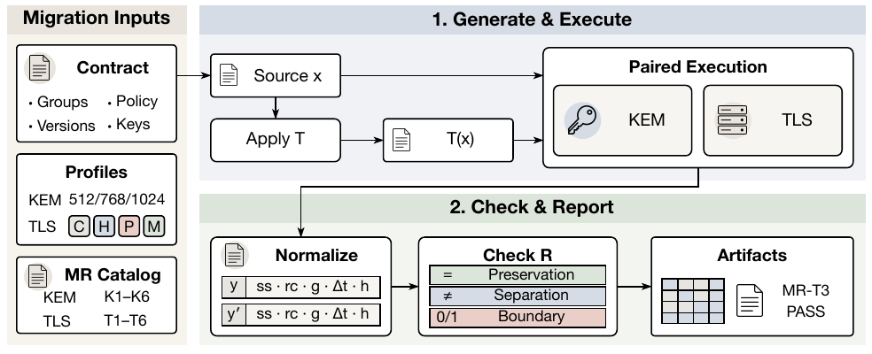
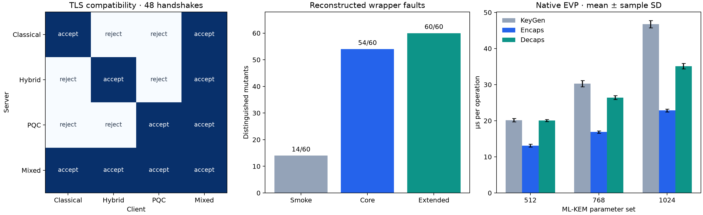

# PQCMorph

**Metamorphic Testing for Behavioral Compatibility in Post-Quantum Cryptography Migration**

PQCMorph tests behavioral contracts that can change during PQC migration: KEM correctness, key serialization, malformed ciphertext handling, TLS compatibility, and downgrade policy. It generates source and follow-up executions and checks the relations between them using OpenSSL.

This anonymous review artifact reconstructs the implementation from the manuscript. It includes executable experiments, recorded observations, and regenerated results. The original source code and experimental data were unavailable; the reconstructed fault variants and additional serialization check are documented explicitly.

## Overview



The workflow takes migration profiles and a relation catalog, runs paired KEM/TLS executions, and reports preservation, separation, and compatibility-boundary outcomes. The figure is extracted from Figure 2 of the manuscript.

## Requirements

- Linux, Python 3.10 or newer.
- OpenSSL 3.5 or newer with ML-KEM and the default provider.
- A C11 compiler and matching OpenSSL development headers/library for native benchmarks.
- Optional: NumPy and Matplotlib for regenerating plots. Verification and numerical reports use the Python standard library.

The included primary results were measured with OpenSSL **3.5.7** on an Intel Core i5-13400F. The manuscript used OpenSSL 3.5.5 and an AMD EPYC host. A separate compatibility run uses OpenSSL 3.6.4.

## Usage

Run commands from the artifact directory. Experiments use fresh processes and loopback connections; no external service is needed.

### 1. Inspect the included results

Read [the measured results](reference/report/RESULTS.md), or open [the visual report](reference/report/index.html) in a browser.



| Experiment | Included result |
|---|---|
| KEM relations, three parameter sets | 720 / 720 checks pass |
| TLS compatibility, four endpoint profiles | 48 / 48 trials match the expected boundary |
| Negative paths | 4 / 4 pass |
| Reconstructed faults: smoke / core / extended | 14 / 54 / 60 distinguished out of 60 |
| Native EVP measurements | 8 repetitions × 2,000 operations per algorithm and operation |

The six serialization-bypass mutants survive the paper-defined core relation. The extended suite adds a key-replacement relation and distinguishes them. These new mutants do not establish reproduction of the lost original 60-case benchmark.

### 2. Verify the included evidence offline

```bash
python scripts/verify.py
python -m unittest discover -s tests -v
```

This checks file integrity, recorded commands and outputs, transformations, relation verdicts, and all unmodified fault controls. It does not rerun cryptographic experiments.

### 3. Run a quick experiment

```bash
openssl version
python scripts/reproduce.py --quick --out runs/quick
```

This runs 18 KEM checks, 16 TLS matrix trials, four negative paths, and a small native benchmark. Open `runs/quick/report/index.html` to inspect the results. Use a new output path for each run.

### 4. Reproduce the full workload

```bash
python scripts/reproduce.py --out runs/full
```

This runs the manuscript-sized core experiments, all 60 reconstructed faults with paired controls, and the full native benchmark. New raw observations and reports are written under `runs/full/`.

If OpenSSL is installed outside the default environment, select its executable and development prefix:

```bash
OPENSSL=/path/to/openssl/bin/openssl python scripts/reproduce.py \
  --prefix /path/to/openssl --out runs/custom
```

### 5. Regenerate tables and figures

```bash
python scripts/report.py --input reference/core \
  --native reference/native.csv --out runs/redrawn
```

This recomputes the statistics from the included observations. With NumPy and Matplotlib available, it also writes PNG/PDF figures.

Experiment settings, individual commands, additional scale/version checks, and limits of reconstruction are described in [the reproduction notes](docs/REPRODUCING.md). The [fault catalog](docs/FAULTS.md) defines each injected behavior and the distinction between the core and extended suites.
